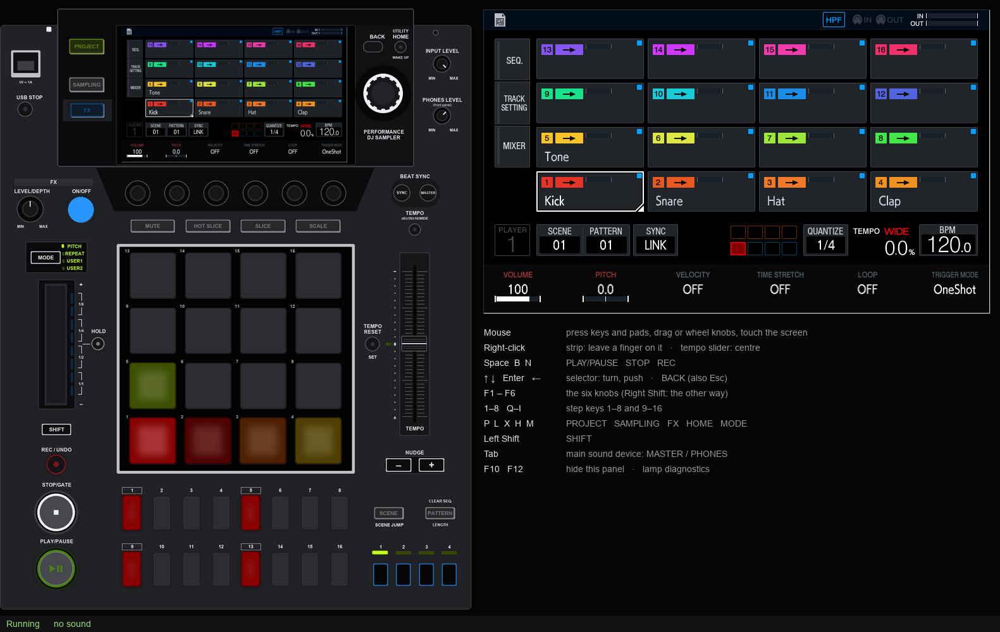

# djs1000-emu

The Pioneer DJ DJS-1000's own application, running on a PC.

The DJS-1000 is an embedded Linux machine (Freescale i.MX6). Its sampler is
one program, `EP113_Main_R`, a JUCE application that draws through X11. This
project runs that program unmodified under `qemu-arm` user mode, inside the
unit's own root filesystem, with a small preloaded library standing in for
the board's devices: the panel microcontroller, the touch strip, GPIO, the
backlight, the sound card. A virtual deck draws the machine around it: its
screen, its lamps as the app lights them, and its controls under the mouse,
with sound in and out.

<p align="center">

</p>

> [!CAUTION]
>
> ## What it is **not**
>
> - **It does not ship Pioneer DJ's firmware.** This repository holds no
>   firmware, nothing unpacked from it, no manuals and no key. You supply
>   your own copy of the public update file (`DJS1000.UPD`, v1.22) and of
>   the key that opens it; `scripts/setup.sh` unpacks the update on your
>   machine, outside the repository.
> - Not endorsed by, affiliated with, or sponsored by AlphaTheta Corporation
>   or Pioneer DJ. DJS-1000, Pioneer DJ, Pro DJ Link and rekordbox are
>   trademarks of their respective owners. The deck's face is drawn by this
>   project, without the maker's logo; the picture above shows the
>   firmware's own interface inside it, for illustration.
> - **Not a replacement for a DJS-1000.** It is an environment for people
>   who own one, to study how it works, to write and try modifications
>   before putting them on the unit, and to test software that talks to it.
>   It has no pressure-sensitive pads, no real audio timing and no
>   hardware, and it needs the firmware and key described below.

## About the key

Pioneer DJ ships the update as an encrypted `.UPD` file. The key that
opens it is the text file `/usr/local/pdj/aes256.key` in the unit's own
root filesystem. It is Pioneer DJ's material, so it is not in this
repository, and no one here has the right to pass it on. Getting a copy
is up to you, by whatever means you are yourself entitled to, for
example from a unit you own. `setup.sh` keeps it as `~/djs/aes256.key`,
readable by you alone, for the tools that need it later.

## State

Working:

- the app starts in about half a minute and runs for as long as you leave it
- the virtual deck ([docs/virtual-deck.md](docs/virtual-deck.md)): every
  control of the panel (buttons, pads, step keys, knobs, the rotary selector,
  the tempo slider, the touch strip), every lamp, and the touch screen
- sound: the master and headphone outputs play on the host's devices, and
  the input is fed from a recording device (LIVE SAMPLING works)
- a USB drive, which is the folder `~/djs/usb`: samples load from
  `PIONEER DJ SAMPLER/Samples` there, and projects are created, saved,
  opened, deleted, saved as packages and rendered to audio
- settings are kept from one run to the next
- `autoexec.bin` on the USB folder is run as the unit runs one from a stick,
  which is how modifications are tried here before a real unit
  ([docs/emulation.md](docs/emulation.md))
- screenshots and scripted input, for exploring it without watching, and a
  recorded regression session (`tools/regress.py`) that comes out identical
  from one run to the next

Not yet:

- MIDI, Pro DJ Link, the network

## Quick start

On Windows, in WSL2 (Ubuntu 24.04); on Linux. `xvfb` is optional: without it
the app's window opens on the X display (WSLg's on Windows).

```sh
sudo apt install qemu-user-static binfmt-support proot squashfs-tools \
    p7zip-full gcc-arm-linux-gnueabihf gdb-multiarch python3 openssl xvfb
scripts/setup.sh /path/to/DJS1000.UPD /path/to/aes256.key    # once: builds ~/djs/root
```

The update file is encrypted: _About the key_ above says what opens it.

Then, on the host (Windows itself, or the Linux machine), once:

```sh
python -m pip install -r requirements.txt    # pygame-ce and Pillow, for the deck
```

and to run it:

```sh
python start.py          # or start.cmd / ./start.sh
```

That starts the emulator (in WSL on Windows), opens the virtual deck when it
answers, and stops the emulator when the deck is closed. `python start.py
--help` lists the options; anything it does not know goes to the deck
(`--audio NAME`, `--headphones NAME`, `--no-input` ...). The app starts on
its PROJECT menu about half a minute later; P closes it.

By hand, the two halves are `scripts/run.sh 3600` (seconds; 0 for no limit)
in WSL and `python app/virtual_djs.py` on the host.

The app's own window is not shown: with `xvfb` installed the app draws on a
display nobody sees, and the deck shows its screen. `python start.py
--window` (or `DJS_WINDOW=1 scripts/run.sh ...`) shows it, and it takes the
keyboard without the deck:

| key | control |
|---|---|
| Escape / Backspace, H | BACK, HOME |
| Space, B, N | PLAY/PAUSE, STOP, REC |
| Enter, `,` / `.` | main encoder push / turn |
| F1–F6 (Shift: other direction) | the six knobs under the screen |
| P | PROJECT |
| 1–8, Q W E R T Y U I | step keys 1–16 |
| L, X, S, `-` | LIVE SAMPLING, FX, SYNC, TEMPO RANGE |
| mouse | touchscreen |

## Layout

| | |
|---|---|
| `shim/djsdev.c` | the stand-ins for the board's devices, and the keyboard, screenshot and command hooks |
| `start.py` (`start.cmd`, `start.sh`) | starts the emulator and the deck together |
| `app/` | the virtual deck |
| `scripts/setup.sh`, `scripts/run.sh` | update file → root filesystem; run the app |
| `scripts/guest/` | what runs inside the root filesystem in place of the unit's start-up |
| `tools/` | `decrypt_upd.py`, `shot.py` (screenshot), `probe.py` (find what an input does), `xref.py` (where a string is used), `make_test_kit.py` (a few synthetic drum samples on the USB folder), `session.py` and `regress.py` (a scripted, recorded session to compare firmware changes against), `deck_selftest.py` |
| `docs/` | what has been worked out: [the update file](docs/update-format.md), [hardware and software](docs/hardware.md), [the emulation](docs/emulation.md), [the panel protocol](docs/panel-protocol.md), [the virtual deck](docs/virtual-deck.md), [power and standby](docs/power-standby.md), [tools](docs/tools.md) |

## Credits

This builds on earlier reverse-engineering notes on the update file and the
unit's debug connectors, shared privately. The panel link follows Pioneer's
own driver, `subucom_spi.c`, from the GPL sources Pioneer DJ publishes for
the DJS-1000. The virtual deck's structure follows the one in
cdj-nxs2-qemu.

## Licence

GPL-2.0-or-later, see [LICENSE](LICENSE).
